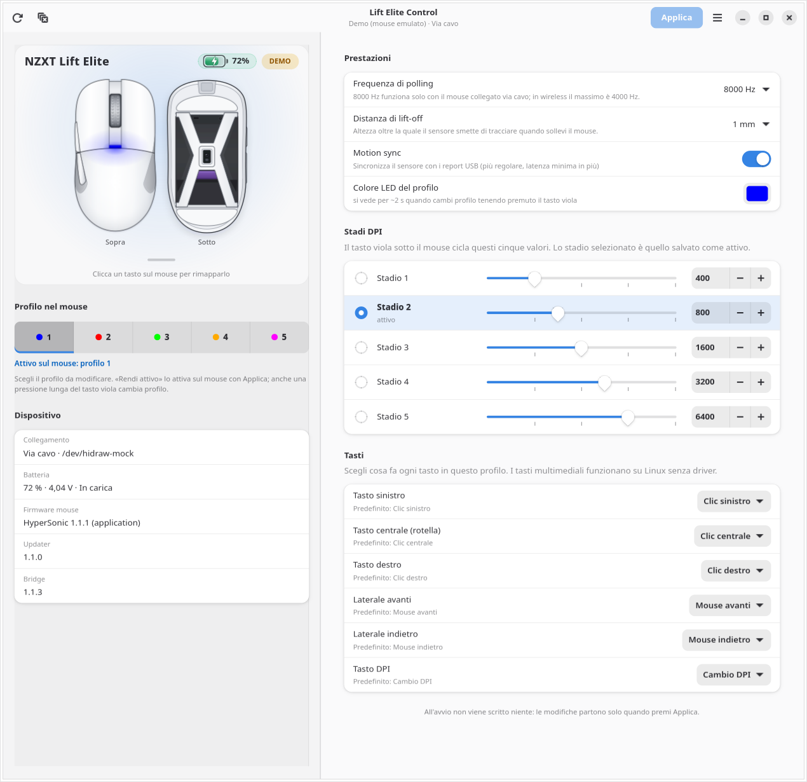
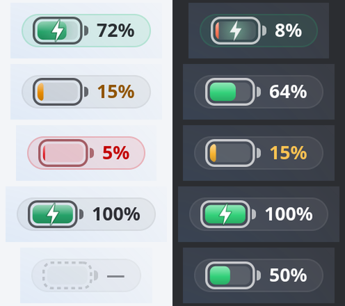

# NZXT Lift Elite su Linux

*[Read in English](README.md)*

Strumenti **non ufficiali** per il mouse **NZXT Lift Elite**, via cavo USB
(`1e71:2129`) o tramite il ricevitore 2,4 GHz (`1e71:2101`):

- **Lift Elite Control**: app grafica GTK4/libadwaita (italiano o inglese)
  per stadi DPI, polling, lift-off, motion sync, mappatura dei tasti,
  profili con nome e livello di batteria, con profilo/stadio DPI attivi in
  tempo reale, applicazione immediata opzionale e ripristino di fabbrica
- **`liftctl`**: riga di comando con le stesse funzioni
- **plugin CoolerControl** (opzionale): stadio DPI, polling, lift-off, motion
  sync e LED del profilo direttamente da CoolerControl
- **`nzxt_lift_elite`**: la libreria Python su cui si basano tutti e tre

Il protocollo HID non è documentato da NZXT: è stato ricostruito osservando
cosa NZXT CAM invia al mouse. Vedi [`PROTOCOL.md`](PROTOCOL.md) e la guida al
reverse engineering ([Italiano](docs/REVERSE_ENGINEERING.it.md) ·
[English](docs/REVERSE_ENGINEERING.md)). Il progetto non è affiliato a NZXT.

Ogni scrittura viene riletta per verificarla e prima di scrivere viene salvato
un backup di tutti i profili. I comandi di aggiornamento firmware non sono
raggiungibili: la libreria li rifiuta.



## Requisiti

- Linux con il driver `hidraw` del kernel (presente ovunque). Gli strumenti
  parlano direttamente con `/dev/hidraw*`: **non servono hidapi né libusb**.
- Python **3.10** o successivo.
- Per `liftctl` e la libreria: nient'altro (solo libreria standard).
- Per la GUI: **GTK 4**, **libadwaita ≥ 1.5**, **PyGObject** e **librsvg**
  (anteprima stilizzata del mouse; se manca librsvg si usa un disegno vettoriale
  incorporato). **pyudev** è consigliato per rilevare subito collegamento e
  scollegamento; senza, l'app controlla `/sys/class/hidraw` ogni 1,5 s.
- Per il plugin CoolerControl: CoolerControl, `grpcio` e `protobuf`, più
  `grpcio-tools` per generare gli stub gRPC.
- Per i permessi senza root: systemd-logind (o elogind) per il tag udev `uaccess`.

Pacchetti tipici:

| Distribuzione | Dipendenze della GUI |
|---|---|
| Arch Linux / CachyOS / Manjaro | `python-gobject gtk4 libadwaita librsvg python-pyudev` |
| Debian / Ubuntu | `python3-gi gir1.2-gtk-4.0 gir1.2-adw-1 gir1.2-rsvg-2.0 python3-pyudev` |
| Fedora | `python3-gobject gtk4 libadwaita librsvg2 python3-pyudev` |

I nomi possono variare tra le versioni; l'importante è che funzioni
`python3 -c "import gi; gi.require_version('Adw', '1'); from gi.repository import Adw"`.

## Installazione dal sorgente

### Opzione A: avvio diretto dal checkout

Non serve installare nulla; i due script di avvio aggiungono il checkout a `sys.path`:

```sh
git clone <questo repository> nzxt-lift-elite
cd nzxt-lift-elite
./liftctl show
./lift-elite-control
```

`./lift-elite-control --mock` apre l'app su un mouse emulato, senza toccare
il dispositivo vero.

### Opzione B: installazione con pip

PyGObject conviene prenderlo dalla distribuzione, quindi crea l'ambiente
virtuale con accesso ai pacchetti di sistema:

```sh
python3 -m venv --system-site-packages ~/.local/share/nzxt-lift-elite-venv
~/.local/share/nzxt-lift-elite-venv/bin/pip install '.[gui]'
```

Così i comandi `liftctl` e `lift-elite-control` finiscono nella `bin/`
dell'ambiente virtuale. `pip install .` da solo installa solo la libreria e
`liftctl` (senza dipendenze della GUI); `pip install '.[hotplug]'` aggiunge
solo pyudev.

Integrazione nel desktop (voce di menu e icona), opzionale, da utente normale:

```sh
install -Dm644 data/io.github.liftelite.Control.desktop -t ~/.local/share/applications/
install -Dm644 data/icons/hicolor/scalable/apps/io.github.liftelite.Control.svg \
  -t ~/.local/share/icons/hicolor/scalable/apps/
```

Il file `.desktop` esegue `lift-elite-control`, quindi quel comando deve
essere nel `PATH`.

## Permessi sul dispositivo (udev)

La regola [`70-nzxt-lift-elite.rules`](70-nzxt-lift-elite.rules) dà
all'utente collegato localmente l'accesso ai nodi hidraw di mouse e
ricevitore tramite il tag `uaccess`. Non serve aggiungersi a nessun gruppo.

```sh
sudo install -m 644 70-nzxt-lift-elite.rules /etc/udev/rules.d/
sudo udevadm control --reload-rules
sudo udevadm trigger -s hidraw
```

Oppure, dopo aver installato la regola, stacca e riattacca il cavo o il
ricevitore. I pacchetti dovrebbero installarla invece in `/usr/lib/udev/rules.d/`.

Se il tuo sistema non usa il meccanismo `uaccess` di logind, adatta la regola
(per esempio `GROUP="plugdev", MODE="0660"`).

## Primo test

Sola lettura, non scrive nulla sul mouse, senza `sudo`:

```sh
liftctl devices         # cosa è collegato (cavo / ricevitore)
liftctl show            # i 5 profili del mouse
liftctl firmware-info   # versioni del firmware
liftctl battery         # percentuale, tensione, stato di carica (sola lettura)
```

`show` deve elencare i cinque profili con polling, lift-off, stadi DPI e
tasti. Se dice "permesso negato", ricontrolla il passo udev. Se il mouse
wireless dorme le letture vanno in timeout: muovilo e riprova.

## Lift Elite Control (GUI)

- **selettore del profilo** 1–5, con il colore del LED di ciascuno e l'indicazione
  di quale è attivo sul mouse. **Rendi attivo** cambia il profilo live
  dall'app (puoi comunque usare la pressione lunga sul tasto viola sotto il
  mouse). Dopo il cambio la libreria riscrive il corpo del profilo, così
  polling e impostazioni del sensore vengono applicati.
- **stadio DPI in tempo reale**: con la finestra in primo piano l'app interroga
  (in sola lettura) il profilo attivo e lo stadio corrente. Una pressione
  breve del tasto viola si vede nell'interfaccia.
- **prestazioni**: polling (avvisa che 8000 Hz va solo via cavo), lift-off
  1/2 mm, motion sync, colore del LED del profilo
- **anteprima del mouse**: un disegno stilizzato e cliccabile, inclusa la
  vista del fondo per il tasto viola. L'altezza dell'anteprima è
  ridimensionabile entro certi limiti (predefinito 280 px, circa 180–420 px;
  doppio clic sull'impugnatura per ripristinare). Le due viste stanno affiancate
  o una sotto l'altra, a seconda della larghezza. Si usa librsvg se c'è,
  altrimenti un disegno vettoriale incorporato.
- **5 stadi DPI** con slider e campo numerico (50–26000, passi di 50); lo
  stadio attivo salvato nel profilo è evidenziato
- **batteria**: percentuale dal fuel gauge del mouse, più tensione, stato
  di carica, temperatura e numero di cicli. Un indicatore sta sulla scheda
  dell'anteprima (i dettagli nel suggerimento e nella sezione Dispositivo).
  Viene letto all'aggancio e poi ogni 30 s via cavo o 60 s tramite il
  ricevitore, solo con la finestra in primo piano, e funziona su entrambi.
- **collegamento in tempo reale**: se attacchi o stacchi il cavo o il
  ricevitore l'app se ne accorge da sola (preferisce il cavo se ci sono
  entrambi); le modifiche non salvate restano e non scrive nulla da sola
- **tasti**: clicca un tasto e scegli l'azione da un elenco con ricerca
  (clic, tasti multimediali, lettere, F1–F24, modificatori…). Le righe dei
  tasti di un profilo che non è attivo sul mouse sono bloccate: una
  rimappatura scrive sempre sul profilo attivo.
- **profili con nome**: salva, carica, elimina, importa/esporta JSON
- **Applica** scrive solo ciò che è cambiato e lo rilegge per verificarlo
  (prima salva un backup in silenzio); **Annulla modifiche** torna ai valori
  letti dal mouse
- **Applica subito**: impostazione opzionale che scrive ogni modifica appena
  la fai (gli slider vengono applicati al rilascio del puntatore)
- **Ripristina impostazioni di fabbrica**: l'icona “cancella tutto” nella
  barra, di fianco a Rileggi, ripristina stadi DPI, polling, lift-off,
  motion sync, colori LED e tasti di fabbrica su tutti e cinque i profili,
  poi torna al profilo che era attivo (prima chiede conferma)
- tema chiaro/scuro che segue il sistema, oppure una preferenza salvata
  (Aspetto nel menu)
- **lingua**: italiano e inglese, dal menu (Lingua), da `--lang`, da
  `LIFT_ELITE_LANG`, dalla preferenza salvata o dalla lingua di sistema

Opzioni: `--device /dev/hidrawN`, `--transport wired|wireless`,
`--theme dark|light`, `--lang it|en`, `--mock`, `--mock-wireless`.

Lo screenshot è del demo incorporato (`lift-elite-control --mock`). Il
titolo mostra “Demo (mouse emulato)” e il collegamento è il percorso
generico `/dev/hidraw-mock`. Altre schermate (elenco azioni, menu, tema
scuro) sono nel [README in inglese](README.md#lift-elite-control-gui).



*Indicatore della batteria: in carica, a batteria, scarica, piena e non
ancora segnalata, nei temi chiaro e scuro.*

## liftctl (riga di comando)

I profili si indicano **1–5** (come nella GUI); nella memoria del mouse e nei
file JSON il campo `profile` è lo slot interno **0–4**. Gli stadi DPI sono
**1–5** (il byte sul filo è 0–4). I testi di aiuto della CLI seguono la
stessa scelta di lingua della GUI (`LIFT_ELITE_LANG`, la preferenza salvata
o la lingua di sistema).

```sh
liftctl show                          # tutti i profili (sola lettura)
liftctl show --profile 1 --json       # un profilo in JSON (slot interno 0)
liftctl devices                       # cavo / ricevitore trovati
liftctl firmware-info                 # versioni firmware (sola lettura)
liftctl battery                       # percentuale, tensione, stato di carica (sola lettura)
liftctl battery --watch 300 --json    # una riga JSON ogni 5 minuti
liftctl debug-dump --out prima.txt    # sola lettura: hex di tutte le letture note

liftctl set --profile 1 --polling 1000 --liftoff 2
liftctl set --profile 1 --dpi 400,800,1600,3200,6400 --stage 2
liftctl set --profile 1 --dpi-stage 2=1000 --motion-sync off
liftctl set --profile 2 --color '#ff0000'
liftctl restore-led-colors            # colori LED di fabbrica (solo quel campo)

liftctl remap --profile 1 --button forward --action volume-up
liftctl remap --profile 1 --button dpi --action key:0x04    # tasto "a"
liftctl remap --profile 1 --reset                            # tasti di fabbrica
liftctl activate --profile 2                                 # rendi attivo il profilo 2
liftctl reset-defaults --yes                                 # predefiniti di fabbrica su tutti e 5 i profili
liftctl actions volume                                       # cerca un'azione

liftctl save FPS --profile 1          # profilo con nome
liftctl profiles                      # elenca i profili con nome
liftctl load FPS --profile 3          # caricalo in un altro slot
liftctl delete FPS
liftctl save --all tutti.json         # tutti e 5 in un file
liftctl --dry-run load --all tutti.json
```

- **Tasti**: `left`, `middle`, `right`, `forward`, `back`, `dpi`
- **Azioni**: `left-click`, `middle-click`, `right-click`, `mouse-forward`,
  `mouse-back`, `dpi-cycle`, `mute`, `volume-up`, `volume-down`, `play-pause`,
  `next-track`, `previous-track`, `stop`, lettere e cifre (`a`, `5`),
  `f1`…`f24`, `enter`, `escape`, `ctrl`, `shift`, `alt`… (`liftctl actions`
  le elenca tutte)
- `key:0xNN` assegna un codice HID della tastiera (pagina 0x07). I codici fuori
  dalla tabella nota richiedono `--allow-unknown-code`.

`set`, `remap` e `load` fanno sempre **lettura → modifica dei soli campi
richiesti → scrittura → rilettura di verifica**. I byte non ancora decodificati
restano com'erano. `remap` viene rifiutato se il profilo di destinazione non
è quello attualmente attivo sul mouse. `activate` rende attivo un profilo
(comando `0x45`) e poi ne riscrive il corpo, così polling e impostazioni del
sensore hanno effetto. `reset-defaults` ripristina i valori di fabbrica noti
su tutti e cinque i profili (serve `--yes`) e lascia selezionato il profilo
che era attivo.

Opzioni globali: `--dry-run` (legge ma non scrive: stampa i pacchetti),
`--debug` (dump esadecimale di ogni pacchetto), `--device /dev/hidrawN`,
`--transport auto|wired|wireless` (con cavo e ricevitore entrambi collegati,
`auto` sceglie il cavo).

### Colori del LED dei profili

Il colore è salvato per ogni profilo in RGB565 e si vede per circa due secondi
quando tieni premuto a lungo il tasto viola per cambiare profilo. In uso
normale (e in carica) il LED è una spia di stato e può restare verde. NZXT CAM
non ha un editor del colore; se un colore personalizzato compaia nel lampeggio
è ancora in prova. `liftctl restore-led-colors` (opzionale `--profile N`)
riscrive i byte di fabbrica esatti:

| profilo | colore | circa | byte RGB565 LE |
|---|---|---|---|
| 1 | Blu | `#0000ff` | `1f00` |
| 2 | Rosso | `#ff0000` | `00f8` |
| 3 | Verde | `#00ff00` | `e007` |
| 4 | Giallo | `#ffaa00` | `40fd` |
| 5 | Viola | `#ff00ff` | `1ff8` |

### File di configurazione

In `~/.config/nzxt-lift-elite/`:

- `settings.json`: lingua, tema, applica-subito e altezza dell'anteprima
- `profiles/*.json`: profili con nome (GUI e `liftctl save NOME`)
- `slots/slot-N.json`: l'ultimo stato scritto in ciascuno slot
- `backups/`: copia dei 5 profili prima di ogni scrittura (gli ultimi 50)

Il formato dei file è descritto nel [README in inglese](README.md#configuration-files).
I campi omessi non vengono toccati al caricamento. I profili con nome non
contengono il colore del LED (i file `--all`, gli export e i backup sì). Anche
i file del formato 1 (versioni precedenti) si caricano.

## Plugin CoolerControl

Il mouse compare in CoolerControl come dispositivo **Lift Elite** con cinque
canali "illuminazione" usati come selettori: stadio DPI (1–5), polling rate
(250…8000 Hz, 8000 solo via cavo), lift-off (1/2 mm), motion sync (on/off) e
LED del profilo (un colore).

Agiscono su **un** profilo, scelto nella pagina del plugin (Impostazioni →
Plugin → NZXT Lift Elite; predefinito il profilo 1). Il plugin scrive solo se
il valore cambia, rilegge per verificare, e *Reset* ripristina il valore letto
all'avvio del plugin. La batteria è disponibile nella GUI e in `liftctl`;
il plugin non la espone (le metriche di stato di CoolerControl non hanno
un campo percentuale).

Installazione manuale dal checkout (la libreria deve essere importabile dal
Python di sistema, ad esempio installata con un pacchetto; servono `grpcio` e
`grpcio-tools`):

```sh
sudo ./cc-plugin/install.sh      # rimozione: sudo ./cc-plugin/uninstall.sh
```

Log: `journalctl -u coolercontrold -u cc-plugin-nzxt_lift_elite -f`.

GUI, `liftctl` e plugin possono girare insieme: un lock esclusivo sul nodo
hidraw impedisce che i pacchetti si mescolino.

## Arch Linux / CachyOS

Un [`PKGBUILD`](packaging/arch/PKGBUILD) locale (split) crea due pacchetti dal
checkout (non scarica nulla dall'AUR):

- `nzxt-lift-elite`: libreria, `liftctl`, l'app, icone, voce di menu e la
  regola udev in `/usr/lib/udev/rules.d/`
- `nzxt-lift-elite-coolercontrol`: il plugin CoolerControl

```sh
cd nzxt-lift-elite/packaging/arch
makepkg -si          # da utente normale, senza sudo: la password la chiede all'installazione
```

Le dipendenze (`python-gobject`, `gtk4`, `libadwaita`, `librsvg`, `python-pyudev`,
`python-grpcio`…) le installa pacman. Per ricompilare e reinstallare la stessa
versione dopo un aggiornamento del checkout: `makepkg -sif`. Se il plugin non
ti serve: `makepkg -s` e poi
`sudo pacman -U nzxt-lift-elite-0.2.0-1-any.pkg.tar.zst`.

Poi stacca e riattacca mouse o ricevitore (oppure usa i comandi `udevadm` qui
sopra) e, se hai installato il plugin:

```sh
sudo systemctl restart coolercontrold
```

Disinstallare:

```sh
sudo pacman -R nzxt-lift-elite-coolercontrol nzxt-lift-elite
```

I profili salvati restano in `~/.config/nzxt-lift-elite/` (cancellali a mano
se vuoi). I comandi funzionano in bash, zsh e fish.

## Cosa non è ancora noto

- la lettura dei tasti e le versioni del ricevitore sono state catturate via
  cavo; attraverso il ricevitore si assume lo stesso protocollo
- **colori LED personalizzati**: vengono salvati e riletti, ma se il lampeggio
  al cambio profilo li mostri è ancora in prova
- **unità della corrente della batteria**: percentuale, tensione, stato di
  carica, temperatura e cicli sono mostrati; l'unità della corrente (~mA) e
  il comportamento esatto della carica vicino al 100 % mentre è in carica
  sono ancora da confermare (`liftctl battery --watch`)

## Test

Senza mouse collegato, dalla radice del progetto:

```sh
python3 -m unittest discover -s tests -t .
```

Usano un hidraw finto (socket) che emula il mouse. La suite è isolata:
`HOME` e `XDG_*` puntano a una cartella temporanea (quindi un `settings.json`
locale, i backup e la lingua scelta non contano), la locale è forzata e i
nodi `/dev/hidraw*` reali non possono essere aperti né trovati. I test che
muovono il puntatore con xdotool partono solo con `LIFT_ELITE_POINTER_TESTS=1`
(su un display di prova, es. `xvfb-run`). I test della GUI richiedono
PyGObject (con cairo) e il smoke test parte solo con un display
(`xvfb-run -a python3 -m unittest tests.test_gui_smoke`); il test gRPC del
plugin richiede `grpcio` e `grpcio-tools`.

## Licenza e avvertenze

GPL-3.0-or-later (vedi [`LICENSE`](LICENSE)); i file `.proto` del plugin
vengono da CoolerControl (GPL-3.0). Lavoro indipendente basato su un protocollo
ricostruito e non supportato: usalo a tuo rischio. NZXT, CAM e Lift Elite sono
marchi dei rispettivi proprietari. Il repository non contiene firmware né
strumenti per aggiornarlo.
