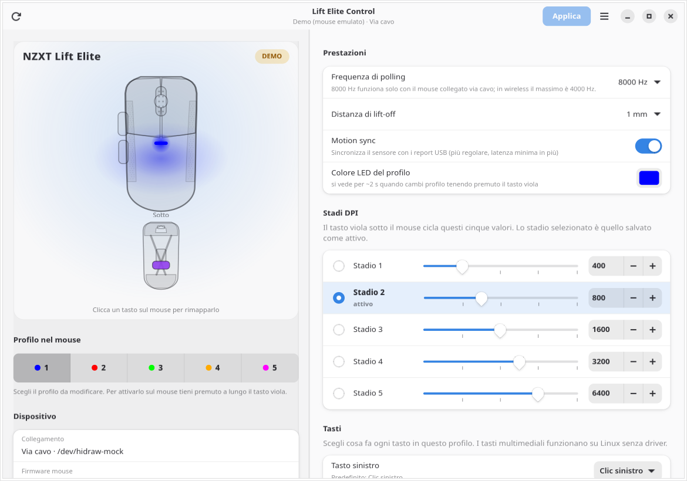

# NZXT Lift Elite on Linux

*[Leggi in italiano](README.it.md)*

**Unofficial** tools for the **NZXT Lift Elite** mouse, over the USB cable
(`1e71:2129`) or the 2.4 GHz receiver (`1e71:2101`):

- **Lift Elite Control**: a GTK4/libadwaita app for DPI stages, polling rate,
  lift-off, motion sync, button mapping and named profiles
- **`liftctl`**: a command-line tool with the same features
- **CoolerControl plugin** (optional): DPI stage, polling, lift-off, motion
  sync and profile LED from inside CoolerControl
- **`nzxt_lift_elite`**: the Python library all three are built on

NZXT does not document the HID protocol. It was reconstructed by watching what
NZXT CAM sends to the mouse; see [`PROTOCOL.md`](PROTOCOL.md) and the
reverse-engineering guide ([English](docs/REVERSE_ENGINEERING.md) ·
[Italiano](docs/REVERSE_ENGINEERING.it.md)). This project is not affiliated
with NZXT.

Every write is read back to verify it, and a backup of all profiles is saved
before writing. Firmware-update commands are unreachable: the library refuses
them.



## Contents

- [Requirements](#requirements)
- [Install from source](#install-from-source)
- [Device permissions (udev)](#device-permissions-udev)
- [First test](#first-test)
- [Lift Elite Control (GUI)](#lift-elite-control-gui)
- [liftctl (command line)](#liftctl-command-line)
- [CoolerControl plugin](#coolercontrol-plugin)
- [Arch Linux / CachyOS](#arch-linux--cachyos)
- [What is not known yet](#what-is-not-known-yet)
- [Python library](#python-library)
- [Tests](#tests)
- [License and disclaimer](#license-and-disclaimer)

## Requirements

- Linux with the kernel `hidraw` driver (standard everywhere). The tools talk
  to `/dev/hidraw*` directly; **no hidapi or libusb is needed**.
- Python **3.10** or newer.
- For `liftctl` and the library: nothing else (standard library only).
- For the GUI: **GTK 4**, **libadwaita ≥ 1.5**, **PyGObject** and
  **librsvg** (stylized mouse preview; a built-in vector drawing is used if
  librsvg is missing). **pyudev** is recommended for instant hot-plug
  detection; without it the app polls `/sys/class/hidraw` every 1.5 s.
- For the CoolerControl plugin: CoolerControl, `grpcio` and `protobuf`, plus
  `grpcio-tools` to generate the gRPC stubs.
- For permissions without root: systemd-logind (or elogind) for the `uaccess`
  udev tag.

Typical distribution packages:

| Distribution | GUI dependencies |
|---|---|
| Arch Linux / CachyOS / Manjaro | `python-gobject gtk4 libadwaita librsvg python-pyudev` |
| Debian / Ubuntu | `python3-gi gir1.2-gtk-4.0 gir1.2-adw-1 gir1.2-rsvg-2.0 python3-pyudev` |
| Fedora | `python3-gobject gtk4 libadwaita librsvg2 python3-pyudev` |

Package names can vary between releases; what matters is that
`python3 -c "import gi; gi.require_version('Adw', '1'); from gi.repository import Adw"`
works.

## Install from source

### Option A: run straight from the checkout

No installation needed; the two launchers add the checkout to `sys.path`:

```sh
git clone <this repository> nzxt-lift-elite
cd nzxt-lift-elite
./liftctl show
./lift-elite-control
```

`./lift-elite-control --mock` opens the app on an emulated mouse without
touching any real device.

### Option B: install with pip

PyGObject is best taken from your distribution, so create the virtual
environment with access to system packages:

```sh
python3 -m venv --system-site-packages ~/.local/share/nzxt-lift-elite-venv
~/.local/share/nzxt-lift-elite-venv/bin/pip install '.[gui]'
```

This installs the `liftctl` and `lift-elite-control` commands into the
virtual environment's `bin/`. `pip install .` alone installs only the library
and `liftctl` (no GUI dependencies); `pip install '.[hotplug]'` adds just
pyudev.

Optional desktop integration (menu entry and icon), as a normal user:

```sh
install -Dm644 data/io.github.liftelite.Control.desktop -t ~/.local/share/applications/
install -Dm644 data/icons/hicolor/scalable/apps/io.github.liftelite.Control.svg \
  -t ~/.local/share/icons/hicolor/scalable/apps/
```

The `.desktop` file runs `lift-elite-control`, so that command must be on
your `PATH`.

## Device permissions (udev)

The rule [`70-nzxt-lift-elite.rules`](70-nzxt-lift-elite.rules) gives the
locally logged-in user access to the mouse and receiver hidraw nodes through
the `uaccess` tag. No group membership is needed.

```sh
sudo install -m 644 70-nzxt-lift-elite.rules /etc/udev/rules.d/
sudo udevadm control --reload-rules
sudo udevadm trigger -s hidraw
```

Or unplug and replug the cable / receiver after installing the rule. Packages
should install it to `/usr/lib/udev/rules.d/` instead.

If your system does not use logind's `uaccess` mechanism, adapt the rule to
your setup (for example `GROUP="plugdev", MODE="0660"`).

## First test

Read-only, writes nothing to the mouse, no `sudo`:

```sh
liftctl devices         # what is connected (cable / receiver)
liftctl show            # the 5 onboard profiles
liftctl firmware-info   # firmware versions
```

`show` should list the five profiles with polling rate, lift-off, DPI stages
and buttons. If you get "permission denied", check the udev step. If the
wireless mouse is asleep, reads time out: move it and try again.

## Lift Elite Control (GUI)

- **profile selector** 1–5, showing each profile's LED colour and which one
  is currently active on the mouse. **Make active** switches the live
  profile from the app (you can still long-press the purple button on the
  bottom). After a switch the library writes the profile body again so the
  polling rate and sensor settings are applied.
- **live DPI stage**: while the window is focused, the app polls the active
  profile and its current stage (read-only). A short press of the purple
  button is reflected in the UI.
- **performance**: polling rate (warns that 8000 Hz works only over the
  cable), lift-off 1/2 mm, motion sync, profile LED colour
- **mouse preview**: a stylized, clickable drawing of the mouse, including
  the underside for the purple button. The preview height is resizable
  within limits (default 280 px, roughly 180–420 px; double-click the handle
  to reset). The two views sit side by side or stack, depending on width.
  librsvg is used when available; otherwise a built-in vector drawing.
- **5 DPI stages** with slider and number field (50–26000, steps of 50); the
  active stage stored in the profile is highlighted
- **live connection**: plugging or unplugging the cable or receiver is
  detected automatically (the cable is preferred when both are present);
  unsaved edits are kept and nothing is written on its own
- **buttons**: click a button and pick an action from a searchable list
  (clicks, media keys, letters, F1–F24, modifiers…). Button rows of a
  profile that is not active on the mouse are locked: a remap always writes
  to the active profile.
- **named profiles**: save, load, delete, import/export JSON
- **Apply** writes only what changed and reads it back to verify (a backup is
  saved silently first); **Discard** goes back to the values read from the mouse
- **Apply immediately**: an optional setting that writes each change as soon
  as you make it (sliders are applied when you release the pointer)
- **Reset to factory defaults**, next to re-read: restores the factory DPI
  stages, polling rate, lift-off, motion sync, LED colours and buttons on
  all five profiles, then returns to the profile that was active
- light/dark theme following the system, or a saved preference
- **language**: English and Italian, from the menu (Language), `--lang`,
  `LIFT_ELITE_LANG`, the saved preference, or the system locale

Options: `--device /dev/hidrawN`, `--transport wired|wireless`,
`--theme dark|light`, `--lang it|en`, `--mock`, `--mock-wireless`.

## liftctl (command line)

Profiles are numbered **1–5** (as in the GUI); in the mouse memory and in JSON
files the `profile` field is the internal slot **0–4**. DPI stages are shown
as **1–5** (the byte on the wire is 0–4). The CLI help follows the same
language selection as the GUI (`LIFT_ELITE_LANG`, the saved preference, or
the system locale).

```sh
liftctl show                          # all profiles (read-only)
liftctl show --profile 1 --json       # one profile as JSON (internal slot 0)
liftctl devices                       # cable / receiver found
liftctl firmware-info                 # firmware versions (read-only)
liftctl debug-dump --out before.txt   # read-only hex dump of all known reads

liftctl set --profile 1 --polling 1000 --liftoff 2
liftctl set --profile 1 --dpi 400,800,1600,3200,6400 --stage 2
liftctl set --profile 1 --dpi-stage 2=1000 --motion-sync off
liftctl set --profile 2 --color '#ff0000'
liftctl restore-led-colors            # factory LED colours (only that field)

liftctl remap --profile 1 --button forward --action volume-up
liftctl remap --profile 1 --button dpi --action key:0x04    # the "a" key
liftctl remap --profile 1 --reset                            # factory buttons
liftctl activate --profile 2                                 # make profile 2 active
liftctl reset-defaults --yes                                 # factory defaults on all 5 profiles
liftctl actions volume                                       # search actions

liftctl save FPS --profile 1          # named profile
liftctl profiles                      # list named profiles
liftctl load FPS --profile 3          # load it into another slot
liftctl delete FPS
liftctl save --all all.json           # all 5 profiles in one file
liftctl --dry-run load --all all.json
```

- **Buttons**: `left`, `middle`, `right`, `forward`, `back`, `dpi`
- **Actions**: `left-click`, `middle-click`, `right-click`, `mouse-forward`,
  `mouse-back`, `dpi-cycle`, `mute`, `volume-up`, `volume-down`, `play-pause`,
  `next-track`, `previous-track`, `stop`, letters and digits (`a`, `5`),
  `f1`…`f24`, `enter`, `escape`, `ctrl`, `shift`, `alt`… (`liftctl actions`
  lists them all)
- `key:0xNN` assigns a HID keyboard usage (page 0x07). Codes outside the known
  table need `--allow-unknown-code`.

`set`, `remap` and `load` always do **read → change only the requested fields
→ write → read back to verify**. Bytes that are not decoded yet are kept as
they were. `remap` is refused unless the target profile is the one currently
active on the mouse. `activate` makes a profile active (command `0x45`) and
then writes its body again so polling and sensor settings take effect.
`reset-defaults` restores the known factory values on all five profiles
(needs `--yes`) and leaves the previously active profile selected.

Global options: `--dry-run` (reads, but prints the packets instead of writing
them), `--debug` (hex dump of every packet), `--device /dev/hidrawN`,
`--transport auto|wired|wireless` (with both cable and receiver connected,
`auto` picks the cable).

### Profile LED colours

The colour is stored per profile as RGB565 and is shown for about two seconds
when you long-press the purple button to change profile. During normal use
(and while charging) the LED is a status light and may stay green. NZXT CAM
has no colour editor; whether a custom colour shows on the flash is still
being tested. `liftctl restore-led-colors` (optionally `--profile N`) writes
back the exact factory bytes:

| profile | colour | approx. | RGB565 LE bytes |
|---|---|---|---|
| 1 | Blue | `#0000ff` | `1f00` |
| 2 | Red | `#ff0000` | `00f8` |
| 3 | Green | `#00ff00` | `e007` |
| 4 | Yellow | `#ffaa00` | `40fd` |
| 5 | Purple | `#ff00ff` | `1ff8` |

### Configuration files

In `~/.config/nzxt-lift-elite/`:

- `settings.json`: language, theme, apply-immediately and preview height
- `profiles/*.json`: named profiles (GUI and `liftctl save NAME`)
- `slots/slot-N.json`: the last state written to each slot
- `backups/`: a copy of the 5 profiles before every write (last 50 kept)

Example file (format 2):

```json
{
  "device": "NZXT Lift Elite",
  "format": 2,
  "name": "FPS",
  "profiles": [
    {
      "polling_hz": 1000,
      "liftoff": 1,
      "dpi_stages": [400, 800, 1600, 3200, 6400],
      "dpi_stage": 2,
      "motion_sync": true,
      "color": "#0000ff",
      "buttons": {"left": "left-click", "middle": "middle-click", "right": "right-click",
                  "forward": "volume-up", "back": "mouse-back", "dpi": "dpi-cycle"}
    }
  ]
}
```

Omitted fields are left untouched when loading. Named profiles do not carry
the LED colour, so loading one into another slot keeps that slot's colour
(`--all` files, exports and backups do include and apply it). Format 1 files
from older versions still load.

## CoolerControl plugin

The mouse appears in [CoolerControl](https://gitlab.com/coolercontrol/coolercontrol)
as a **Lift Elite** device with five "lighting" channels used as selectors:

| channel | values |
|---|---|
| DPI stage | stage 1–5 (current DPI in the label) |
| Polling rate | 250 … 8000 Hz (8000 only over the cable) |
| Lift-off | 1 mm / 2 mm |
| Motion sync | on / off |
| Profile LED | a colour |

They act on **one** onboard profile, chosen on the plugin page (Settings →
Plugins → NZXT Lift Elite; profile 1 by default). The plugin writes only when a
value changes, reads it back, and *Reset* restores the value read when the
plugin started. Battery and other sensors are not exposed yet.

Manual install from the checkout (the library must be importable by the
system Python, e.g. installed system-wide or by a package; `grpcio` and
`grpcio-tools` are required):

```sh
sudo ./cc-plugin/install.sh      # removal: sudo ./cc-plugin/uninstall.sh
```

It installs to `/var/lib/coolercontrol/plugins/nzxt_lift_elite/` (manifest,
page, `config.json`) and `/usr/lib/nzxt-lift-elite/coolercontrol/` (Python
server and gRPC stubs) and restarts `coolercontrold`. Logs:
`journalctl -u coolercontrold -u cc-plugin-nzxt_lift_elite -f`.

The GUI, `liftctl` and the plugin can run at the same time: an exclusive lock
on the hidraw node keeps their packets from interleaving.

## Arch Linux / CachyOS

A local split [`PKGBUILD`](packaging/arch/PKGBUILD) builds two packages from the
checkout (nothing is downloaded from the AUR):

- `nzxt-lift-elite`: library, `liftctl`, the app, icons, desktop entry and the
  udev rule in `/usr/lib/udev/rules.d/`
- `nzxt-lift-elite-coolercontrol`: the CoolerControl plugin

```sh
cd nzxt-lift-elite/packaging/arch
makepkg -si          # as a normal user, without sudo; asks for the password at install time
```

Dependencies (`python-gobject`, `gtk4`, `libadwaita`, `librsvg`, `python-pyudev`,
`python-grpcio`…) are installed by pacman. To rebuild and reinstall the same
version after pulling changes, use `makepkg -sif`. If you do not need the
plugin: `makepkg -s`, then
`sudo pacman -U nzxt-lift-elite-0.2.0-1-any.pkg.tar.zst`.

Afterwards replug the mouse/receiver (or run the `udevadm` commands above),
and if you installed the plugin:

```sh
sudo systemctl restart coolercontrold
```

Uninstall:

```sh
sudo pacman -R nzxt-lift-elite-coolercontrol nzxt-lift-elite
```

Saved profiles stay in `~/.config/nzxt-lift-elite/` (remove it by hand if you
want). The commands above work in bash, zsh and fish.

## What is not known yet

- button reads and receiver versions were captured over the cable; the same
  protocol is assumed through the receiver
- **custom LED colours**: stored and read back, but whether the profile-change
  flash shows them is still being tested
- **battery**: not exposed; the status reply that probably contains it is not
  decoded with certainty

## Python library

```python
from nzxt_lift_elite import LiftElite

with LiftElite.open() as mouse:          # transport="wired"/"wireless" to force one
    p = mouse.read_profile(0)            # the library uses slots 0..4
    new = p.with_changes(polling_hz=1000, dpi_stages={2: 1000}, buttons={"forward": "volume-up"})
    mouse.apply_profile(new)             # writes only the differences and verifies
```

Modules: `protocol` (packets, no I/O), `actions` (action table), `profile`
(model and JSON), `device` (discovery and I/O), `hotplug`, `store` (named
profiles), `settings`, `i18n`, `mock` (emulated mouse for tests), `cli`,
`gui`.

## Tests

No mouse needed, from the project root:

```sh
python3 -m unittest discover -s tests -t .
```

They use a fake hidraw (socket) that emulates the mouse. The suite is
hermetic: `HOME` and `XDG_*` point to a temporary directory (so a local
`settings.json`, backups and language preference are ignored), the locale is
forced, and real `/dev/hidraw*` nodes cannot be opened or discovered. Tests
that move the pointer with xdotool run only with `LIFT_ELITE_POINTER_TESTS=1`
(on a throwaway display, e.g. `xvfb-run`). The GUI tests need PyGObject
(with cairo) and run the smoke test only with a display
(`xvfb-run -a python3 -m unittest tests.test_gui_smoke`); the plugin's gRPC
test needs `grpcio` and `grpcio-tools`.

## License and disclaimer

GPL-3.0-or-later (see [`LICENSE`](LICENSE)); the plugin's `.proto` files come
from CoolerControl (GPL-3.0). Independent work based on a reconstructed,
unsupported protocol: use at your own risk. NZXT, CAM and Lift Elite are
trademarks of their respective owners. This repository contains no firmware
and no tools to update it.
